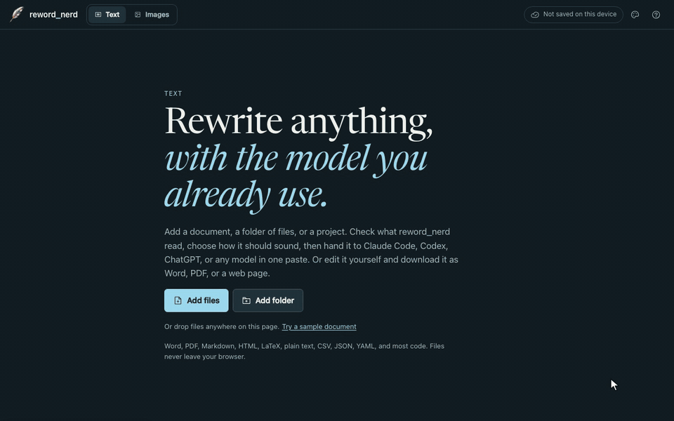

<p align="center"></p>

<h1 align="center">reword_nerd</h1>

<p align="center">Rewrite documents and regenerate images with the AI model you already use.</p>

<p align="center">
  <a href="https://ryanjosephkamp.github.io/reword-nerd/"><strong>Open reword_nerd</strong></a> ·
  <a href="https://ryanjosephkamp.github.io/reword-nerd/updates/">Updates</a> ·
  <a href="https://github.com/ryanjosephkamp/reword-nerd/issues/new/choose">Report a problem</a>
</p>



<sub>A scripted demo on the real app. The agent's run is simulated; no model was called.</sub>

reword_nerd reads your files in the browser, lets you check what it read, and then hands the
job to Claude Code, Codex, ChatGPT, Grok Imagine, or any other model in as few pastes as
possible. There is no server and no account; your files never leave your browser.

## How it works

1. **Add** documents (Word, PDF, Markdown, HTML, LaTeX, plain text, CSV, JSON, YAML, and most
   code), a folder or ZIP project, or images.
2. **Check** the text that was read. Fix mistakes, accept text found in scanned pages, and
   choose which files take part. Dependency folders, build output, and files that look like
   credentials are left out on their own.
3. **Set** the goal, tone, length, and language. For images, say what should change and what
   must stay.
4. **Hand off** to where the work will run:
   - **Coding agents** (Claude Code, Codex, Gemini CLI): download a task folder and paste one
     command. The agent writes the results in the original format, Word files included.
   - **Chat apps** (ChatGPT, Claude, Gemini, Grok): copy one prompt. A step-by-step mode with
     four prompts is there for long or delicate documents.
   - **Image tools** (Grok Imagine, ChatGPT, Gemini, Midjourney): attach the image and paste its
     prompt, or give Codex a folder of images to do in one go.
5. **Bring it back** if you like: paste the reply or drop the agent's finished folder to see the
   changes line by line, the model's own check, and a download in the original format.

Every rewrite follows four stages: **Decompose** the meaning, **Rewrite** it in new words,
**Verify** that nothing was lost or added, and produce the **Final** version.

## Without a model

You can also do the rewording yourself. Edit the document right on the page, see every change in
red and green, and download it as Word, PDF, a web page, Markdown, or plain text. Pick a paper
style (Paper, White, Sepia, or Night), a typeface, and a size, and the download uses the same
look.

## Privacy

reword_nerd is a static web page. Files are read on your device, and nothing is sent anywhere
unless you copy it or download it. Saving your workspace between visits is off until you turn it
on, and then it stays in your browser. You can export the workspace as a ZIP at any time.

## Development

Requires Node.js 22 or later.

```sh
npm install
npm run dev
```

| Command         | What it does                                                   |
| --------------- | -------------------------------------------------------------- |
| `npm run check` | Lint, format check, typecheck, unit tests, and build           |
| `npm test`      | Unit tests                                                     |
| `npm run e2e`   | Browser tests on desktop and phone sizes, with axe-core checks |
| `npm run build` | Builds the landing page, the app, Updates, and redirects       |

| Where                        | What                                                           |
| ---------------------------- | -------------------------------------------------------------- |
| `index.html`, `src/landing/` | The landing page                                               |
| `app/index.html`, `src/app/` | The app                                                        |
| `src/engine/`                | Reading files, writing prompts, building task folders, exports |
| `content/updates/`           | Updates posts, one Markdown file each                          |
| `scripts/themes.mjs`         | Generates the color palettes and checks their contrast         |
| `scripts/demo/record.mjs`    | Re-records the demo after a build (needs ffmpeg and cwebp)     |
| `.github/workflows/`         | Checks every pull request and deploys `main` to GitHub Pages   |

See [Contributing](CONTRIBUTING.md) to help, and the [security policy](SECURITY.md) to report a
vulnerability privately.

## License

[MIT](LICENSE)
